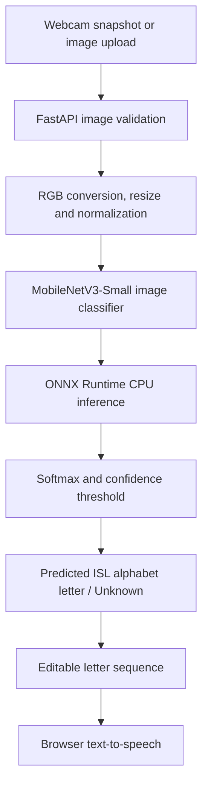

# SignBridge AI — Image-Only ISL Alphabet Recognition

SignBridge AI is a full-stack research starter that recognizes **static Indian Sign Language (ISL) alphabet hand signs (A–Z)** from a single image. Users can capture a webcam snapshot or upload a JPG, PNG, or WebP image. The image is classified by a fine-tuned **MobileNetV3-Small** model and the API returns the predicted letter, confidence, and top alternatives.

> **Scope and honesty:** this is an image classifier for static alphabet/fingerspelling poses. It is not a continuous sign-language recognizer, does not understand motion-dependent signs, and does not translate ISL grammar or complete sentences into English. The app can collect predicted letters into editable text and read that text aloud. No trained checkpoint or accuracy claim is included in the repository; you train the model on the dataset you download.

## Contents

- [Dataset](#1-dataset)
- [Architecture](#2-architecture)
- [Project structure](#3-project-structure)
- [Requirements](#4-requirements)
- [Download and prepare the dataset](#5-download-and-prepare-the-dataset)
- [Train, evaluate, and export](#6-train-evaluate-and-export-the-model)
- [Run locally](#7-run-the-application-locally)
- [API reference](#8-api-reference)
- [Tests and quality checks](#9-tests-and-quality-checks)
- [Deploy online for free](#10-deploy-online-for-free)
- [Change labels or model](#11-change-the-dataset-model-or-language)
- [Limitations and roadmap](#12-limitations-and-roadmap)

---

## 1. Dataset

### Recommended: Indian Sign Language Alphabet Image Dataset

**Download:** [ayesha-hannure/Indian-Sign-Language-dataset](https://github.com/ayesha-hannure/Indian-Sign-Language-dataset)

Direct image archive: [dataset_ISL.zip](https://github.com/ayesha-hannure/Indian-Sign-Language-dataset/raw/refs/heads/main/dataset_ISL.zip)

The repository describes the image collection as:

- Approximately **12,700 images**.
- **26 classes**, representing English alphabet letters A–Z.
- Approximately **486 processed/augmented images per class**.
- The image archive is listed as **115 MB** in GitHub and is stored using Git LFS.
- The repository also contains `csv_ISL.zip`; this project uses the image archive, not the pixel-value CSV files.

The repository displays an Apache-2.0 license. Review the dataset repository and its license before redistribution or commercial use, and cite the dataset authors in academic work. Dataset facts and download links are taken from the [dataset repository and README](https://github.com/ayesha-hannure/Indian-Sign-Language-dataset).

**Important dataset-quality note:** the dataset README says its images are processed and augmented. The training script creates a random stratified split for development, but augmented or near-duplicate images may land in different splits. Therefore, test scores from this split may be optimistic and should not be presented as signer-independent or as a real-world benchmark. For stronger evaluation, collect new images from people not represented in training and keep those images in a separate test folder.

### Optional alternative: RealSign ISL

[RealSign-Indian-Sign-Language-Dataset](https://github.com/RealSign62/RealSign-Indian-Sign-Language-Dataset) describes a larger 26-class image dataset with separate Training, Testing, and Validation directories. Its README lists approximately 700/200/100 images per class in those splits. It is a useful alternative if you want explicit directory splits, but is larger than the recommended starter dataset. The current training script is optimized for the recommended single-root image folder; adapt the split handling before using RealSign's official split directories.

**Do not mix ISL and ASL labels.** This model is configured for ISL. ASL uses different signs and needs its own dataset, checkpoint, and label map.

---

## 2. Architecture



### Technology stack

| Layer | Technology | Responsibility |
|---|---|---|
| Frontend | React, TypeScript, Vite | Webcam preview, snapshot capture, image upload, result display, letter builder |
| API | FastAPI | Image upload validation, health/model endpoints, prediction response |
| Training | PyTorch, torchvision | Fine-tune MobileNetV3-Small |
| Inference | ONNX Runtime CPU | Load exported ONNX model without PyTorch in the web runtime |
| Image processing | Pillow, NumPy | EXIF orientation, RGB conversion, resize/crop, normalization |
| Deployment | Docker | Serve compiled React frontend and FastAPI from one service |

### Why ONNX Runtime for serving?

PyTorch and torchvision are required to train the model, but the deployed API only needs ONNX Runtime. Exporting the trained model to ONNX avoids installing the full training stack in the inference container and makes a small CPU deployment more practical.

---

## 3. Project structure

```text
signbridge-ai/
├── backend/
│   ├── app/
│   │   ├── core/config.py
│   │   ├── inference/predictor.py       # ONNX Runtime image inference
│   │   ├── main.py                      # FastAPI routes and static frontend
│   │   └── models/
│   ├── tests/
│   ├── requirements.txt                # Small inference dependencies
│   └── Dockerfile
├── frontend/
│   ├── src/App.tsx                      # Webcam snapshot + image upload UI
│   ├── src/style.css
│   └── package.json
├── ml/
│   ├── datasets/image_dataset.py        # ImageFolder discovery
│   ├── models/image_classifier.py       # MobileNetV3-Small
│   ├── training/train_image.py          # Train/validation/test split
│   ├── training/export_onnx.py          # PyTorch -> ONNX + label metadata
│   ├── evaluation/evaluate_image.py     # Held-out test evaluation
│   └── requirements-train.txt           # Training-only dependencies
├── scripts/inspect_dataset.py
├── data/raw/                            # Download/extract dataset here (ignored by Git)
├── data/processed/                      # Optional generated files
├── artifacts/                           # Add exported ONNX model + JSON labels here
├── Dockerfile                           # Full-stack production container
├── docker-compose.yml
├── .env.example
└── README.md
```

There is no video upload pipeline, WebSocket stream, MediaPipe dependency, landmark extractor, or temporal model in this version. The old `/api/v1/predict/video` route returns HTTP 410 and tells clients to use the image endpoint.

---

## 4. Requirements

- Python **3.11** recommended.
- Node.js **20+** and npm.
- Git and Git LFS (for the recommended dataset archive).
- Webcam for snapshot recognition; image upload works without a webcam.
- Training can run on CPU, but a CUDA-compatible GPU or Google Colab GPU will make fine-tuning faster.
- Deployment uses CPU inference; no GPU is required.

### Windows PowerShell setup

Run from the repository root:

```powershell
py -3.11 -m venv .venv
.\.venv\Scripts\Activate.ps1
python -m pip install --upgrade pip

# API/inference dependencies
pip install -r backend/requirements.txt

# Training dependencies (PyTorch + torchvision + ONNX exporter)
pip install -r ml/requirements-train.txt
```

If you want CPU-only PyTorch wheels, install the matching CPU wheels first using the [official PyTorch install selector](https://pytorch.org/get-started/locally/), then install the remaining packages in `ml/requirements-train.txt`.

### macOS / Linux

```bash
python3.11 -m venv .venv
source .venv/bin/activate
python -m pip install --upgrade pip
pip install -r backend/requirements.txt
pip install -r ml/requirements-train.txt
```

If training and API development happen in separate environments, the inference environment only needs `backend/requirements.txt`. Keep the training environment separate if you want a smaller deployment build.

---

## 5. Download and prepare the dataset

### Option A — browser download (easiest)

1. Open the [dataset GitHub repository](https://github.com/ayesha-hannure/Indian-Sign-Language-dataset).
2. Download `dataset_ISL.zip` (115 MB Git LFS object).
3. Extract it under `data/raw/ISL/`.
4. Find the directory that contains one folder per class, A through Z.

Expected layout:

```text
data/raw/ISL/
└── dataset_ISL/                 # wrapper folder name may differ
    ├── A/
    │   ├── image_001.jpg
    │   └── ...
    ├── B/
    ├── C/
    └── ...
```

The loader automatically searches the supplied directory and one level below it for class folders. If the extracted archive contains another wrapper folder, pass the wrapper directory to the commands below.

### Option B — Git LFS download

Install Git LFS first from [git-lfs.com](https://git-lfs.com/), then:

```bash
git lfs install
git clone https://github.com/ayesha-hannure/Indian-Sign-Language-dataset.git
```

Copy/extract `dataset_ISL.zip` into `signbridge-ai/data/raw/ISL/`.

### Inspect the folder structure

From the project root:

```bash
python scripts/inspect_dataset.py data/raw/ISL
```

It prints the detected ImageFolder root, class names, and image count per class. If it cannot find class folders, inspect the extracted archive and pass the exact directory containing A, B, C, ... subfolders.

**The class folder name is the label.** The current app expects 26 alphabet labels. Do not put unrelated files, README documents, or CSV files inside the class folders.

---

## 6. Train, evaluate, and export the model

### 6.1 Train MobileNetV3-Small

```bash
python -m ml.training.train_image \
  --data data/raw/ISL \
  --output artifacts/isl_mobilenet.pth \
  --epochs 15 \
  --batch-size 32 \
  --lr 0.0001
```

Windows PowerShell (single line):

```powershell
python -m ml.training.train_image --data data/raw/ISL --output artifacts/isl_mobilenet.pth --epochs 15 --batch-size 32 --lr 0.0001
```

Defaults:

| Setting | Default |
|---|---:|
| Architecture | MobileNetV3-Small |
| Image input | 224 × 224 RGB |
| Classes | Inferred from class folders (A–Z expected) |
| Optimizer | AdamW |
| Learning rate | 0.0001 |
| Batch size | 32 |
| Epochs | 15 |
| Split | 70% train / 15% validation / 15% test |
| Seed | 42 |
| Initialization | ImageNet pretrained weights |

The script applies modest random crop, rotation, and color augmentation to training images. It does not apply horizontal flips by default because mirroring may alter sign meaning. It saves the best validation macro-F1 checkpoint and the test indices to `artifacts/isl_mobilenet.pth`.

To avoid downloading ImageNet weights (for offline training), add `--no-pretrained`. Training from random initialization may need more data/epochs and can perform worse.

### 6.2 Evaluate on the held-out test split

```bash
python -m ml.evaluation.evaluate_image \
  --data data/raw/ISL \
  --checkpoint artifacts/isl_mobilenet.pth
```

The evaluator reports accuracy, macro-F1, per-class precision/recall/F1, and a confusion matrix. It uses the test indices saved by the training run.

**Evaluation caveat:** the default split is stratified and reproducible, but it is random at image level. If the dataset contains pre-augmented images, near-duplicates can cross the split. Do not claim signer-independent generalization from this score. A stronger experiment should use fresh test images from different signers, backgrounds, devices, and lighting conditions.

### 6.3 Export ONNX for API/deployment

```bash
python -m ml.training.export_onnx \
  --checkpoint artifacts/isl_mobilenet.pth \
  --output artifacts/isl_mobilenet.onnx
```

This creates two deployment files:

```text
artifacts/
├── isl_mobilenet.onnx     # model used by FastAPI/ONNX Runtime
└── isl_mobilenet.json     # ordered labels and preprocessing metadata
```

The API requires **both files**. Do not rename one without renaming the other. The `.pth` checkpoint is used for future training/evaluation; the API only loads the `.onnx` and matching `.json` files.

### 6.4 Optional quick dataset smoke test

Before a full training run, inspect the dataset and run a short experiment:

```bash
python -m ml.training.train_image --data data/raw/ISL --output artifacts/smoke.pth --epochs 1 --batch-size 16
```

This checks that the directory structure and image files can be loaded. It is not a final model configuration.

---

## 7. Run the application locally

### Terminal 1 — FastAPI backend

Create a root `.env` if you want to override defaults. The default model path is `artifacts/isl_mobilenet.onnx`.

```bash
uvicorn backend.app.main:app --reload --host 127.0.0.1 --port 8000
```

API docs: [http://127.0.0.1:8000/docs](http://127.0.0.1:8000/docs)

### Terminal 2 — React frontend

```bash
cd frontend
npm install
```

Create `frontend/.env.local` with:

```env
VITE_API_BASE_URL=http://localhost:8000
```

Then start Vite:

```bash
npm run dev
```

Open [http://localhost:5173](http://localhost:5173).

The webcam browser API requires `localhost` or HTTPS. If you have not trained/exported a model yet, the UI still starts but the API returns `model_unavailable` rather than inventing a prediction.

### Local Docker

After exporting the ONNX model and creating the two artifact files:

```bash
docker compose up --build
```

Open [http://localhost:8000](http://localhost:8000). The same container serves the React build and API.

---

## 8. API reference

| Method | Endpoint | Description |
|---|---|---|
| `GET` | `/api/v1/health` | API status, model readiness, runtime |
| `GET` | `/api/v1/models` | Loaded architecture, label count and labels |
| `GET` | `/api/v1/languages` | Supported language/scope metadata |
| `POST` | `/api/v1/predict/image` | Predict from multipart image field named `file` |
| `POST` | `/api/v1/predict/video` | Retired endpoint; returns HTTP 410 |
| `GET` | `/docs` | Interactive Swagger API docs |

### Example image request

```bash
curl -X POST http://localhost:8000/api/v1/predict/image \
  -F "file=@sample-sign.jpg"
```

Example response (illustrative shape, not an actual prediction):

```json
{
  "status": "ok",
  "label": "A",
  "confidence": 0.91,
  "alternatives": [
    {"label": "A", "confidence": 0.91},
    {"label": "S", "confidence": 0.05},
    {"label": "M", "confidence": 0.02}
  ],
  "language": "ISL"
}
```

The API accepts JPEG, PNG, and WebP uploads up to `MAX_UPLOAD_MB` (default 10 MB). It checks the actual image data, applies EXIF orientation, converts to RGB, and returns top-3 predictions. `CONFIDENCE_THRESHOLD` controls when the best prediction is returned as `Unknown sign`.

### Environment variables

| Variable | Default | Purpose |
|---|---|---|
| `MODEL_PATH` | `artifacts/isl_mobilenet.onnx` | ONNX checkpoint path |
| `SIGN_LANGUAGE` | `ISL` | Displayed language identifier |
| `CONFIDENCE_THRESHOLD` | `0.60` | Below this score return Unknown |
| `MAX_UPLOAD_MB` | `10` | Upload limit |
| `CORS_ORIGINS` | localhost Vite URLs | Comma-separated frontend origins |
| `PORT` | `10000` in Docker | Host-provided HTTP port |

---

## 9. Tests and quality checks

### Backend tests

```bash
pip install pytest httpx
pytest backend/tests -q
```

Tests cover API health, retired video endpoint behavior, image upload validation, preprocessing tensor shape, and missing-model handling. The model architecture smoke test is in `ml/tests` and requires the training dependencies.

### Frontend production build

```bash
cd frontend
npm install
npm run build
```

### Python syntax check

```bash
python -m compileall -q backend ml scripts
```

### CI

GitHub Actions runs backend tests and a frontend TypeScript/Vite production build on pushes and pull requests. The CI job does not train a model or download dataset files.

---

## 10. Deploy online for free

The simplest deployment for this repository is one Docker web service containing the React static build, FastAPI, ONNX Runtime, and your small exported model. Training is performed locally or in a notebook; only the ONNX inference model is deployed.

### Before deployment

1. Train and evaluate the model.
2. Export `artifacts/isl_mobilenet.onnx` and `artifacts/isl_mobilenet.json`.
3. Confirm both files exist and that their distribution is permitted by the dataset/model terms.
4. Add the ONNX model and metadata to your Git repository. The `.pth` training checkpoint and raw dataset are ignored by Git. The ONNX model is intentionally not ignored.
5. Never commit the raw image dataset unless you have checked redistribution permissions.

### Option A — Render free Docker web service

Official docs: [Render free services](https://render.com/docs/free), [Docker/web services](https://render.com/docs/web-services), [first deploy walkthrough](https://render.com/docs/your-first-deploy).

1. Push this project to a GitHub repository.
2. Sign in to Render and choose **New → Web Service**.
3. Connect your GitHub repository.
4. Select **Docker** as the runtime. Render detects the root `Dockerfile`.
5. Choose the **Free** instance if it is available for your account/workspace.
6. Add environment variables:
   - `MODEL_PATH=artifacts/isl_mobilenet.onnx`
   - `SIGN_LANGUAGE=ISL`
   - `CONFIDENCE_THRESHOLD=0.60`
   - `MAX_UPLOAD_MB=10`
   - `CORS_ORIGINS` can remain empty/default for the single-container deployment.
7. Set health check path to `/api/v1/health` if the dashboard offers it.
8. Deploy. Render supplies `PORT`; the Docker command binds to `0.0.0.0` and uses that port.
9. Open the generated `https://<service-name>.onrender.com` URL.

**Free-tier limitations:** Render free web services spin down after 15 minutes without inbound traffic, so the first request after idle may take around a minute. Their filesystem is ephemeral; files written at runtime disappear on restart/redeploy/spin-down. Do not store user uploads or durable data there. Free instances are for demos/hobby projects, not production SLAs. The MobileNet ONNX file is bundled at build time, so model availability does not depend on a runtime upload. Check Render's current free plan limits before deploying; see the official [free plan documentation](https://render.com/docs/free).

If the free instance runs out of memory or exceeds its limits, deploy the frontend separately and use a smaller model/input, or use a paid instance. Do not promise continuous availability on a free plan.

### Option B — Vercel frontend + Render backend

Use this if you prefer Vercel for the React frontend.

**Backend on Render**

1. Deploy the backend as a Docker Web Service. You can use the root Dockerfile (full stack) or `backend/Dockerfile` (API-only).
2. If using the API-only Dockerfile, set its Dockerfile path in Render to `backend/Dockerfile` and make sure the ONNX and JSON files are in the root `artifacts/` directory in the build context. If the platform's Docker build context is restricted to `backend/`, use the root Dockerfile instead.
3. Set `CORS_ORIGINS=https://YOUR-PROJECT.vercel.app`.
4. Copy the Render backend URL, e.g. `https://your-api.onrender.com`.

**Frontend on Vercel**

1. Import the repository into Vercel.
2. Set the project root directory to `frontend`.
3. Framework preset: Vite.
4. Build command: `npm run build`.
5. Output directory: `dist`.
6. Add environment variable `VITE_API_BASE_URL=https://your-api.onrender.com`.
7. Deploy, then update backend `CORS_ORIGINS` with the exact Vercel production URL (and preview URL only if required).

The Render backend still has free-tier cold starts and ephemeral filesystem limitations. Vercel hosts only the static frontend; it does not run this FastAPI/PyTorch training backend.

### Hugging Face Spaces note

Hugging Face offers free Static Spaces, but the current React + FastAPI application needs a running backend. The current Spaces documentation says Docker/Gradio Spaces that run on compute require an eligible paid plan for regular compute; free personal accounts may have limited ZeroGPU Gradio options. Therefore, do not treat a Docker Space as a guaranteed free deployment for this project. See [Spaces overview and hardware/plan details](https://huggingface.co/docs/hub/spaces-overview).

---

## 11. Change the dataset, model, or language

### Use another image dataset

1. Make an image folder where each immediate subfolder is a class label.
2. Use only one sign language per dataset/model.
3. Run `python scripts/inspect_dataset.py <dataset-root>`.
4. Train with `python -m ml.training.train_image --data <dataset-root> ...`.
5. Evaluate and export ONNX.
6. Deploy both the `.onnx` and matching `.json` metadata.

The loader supports a direct `root/class/image.jpg` layout and searches one wrapper directory below the supplied root. If your archive has deeper or metadata-based organization, adapt `ml/datasets/image_dataset.py` to the official annotation structure rather than relabeling images by guesswork.

### Change the classifier

The baseline is in `ml/models/image_classifier.py`. Replace `build_image_model` with another torchvision image architecture, keeping the same RGB input shape and output class count. Retrain, re-evaluate, and export a new ONNX file. Update the API's metadata/model path together.

### Change the confidence threshold

Set `CONFIDENCE_THRESHOLD` in `.env` or the deployment dashboard. The API reads `CONFIDENCE_THRESHOLD` at startup and applies it after model loading. Do not interpret a high softmax score as calibrated certainty without calibration experiments.

### Add digits or more static signs

Add digit folders only if the dataset contains correct, consistently defined ISL digit signs. Retrain with the expanded class set; the output labels are inferred from folder names. The UI can display labels beyond A–Z, but the current word builder simply concatenates predicted labels and may need UX changes for digits/word signs.

---

## 12. Limitations and roadmap

### Implemented

- Static image-based ISL alphabet classifier (A–Z after training on the recommended dataset).
- Webcam preview and single-frame snapshot prediction.
- JPEG, PNG, and WebP image upload.
- MobileNetV3-Small transfer-learning training pipeline.
- Stratified train/validation/test split and classification metrics.
- PyTorch checkpoint and ONNX export.
- ONNX Runtime CPU inference, top-3 alternatives, and confidence-based unknown rejection.
- Editable letter sequence, browser text-to-speech, and temporary browser-session history.
- Dockerized full-stack deployment.

### Not implemented

- Video or real-time continuous signing.
- Motion-dependent ISL signs.
- Sign boundary detection or temporal models (GRU/LSTM/Transformer/CTC).
- ISL grammar understanding or natural-language sentence translation.
- Signer-independent benchmark protocol for the recommended image collection.
- User accounts, persistent recognition history, database, or durable image storage.
- A pretrained model/checkpoint included in this repository.

### Suggested roadmap

1. Collect a signer-diverse ISL alphabet image set with participant consent and documented splits.
2. Add a separate unknown/background class and calibrate the rejection threshold.
3. Evaluate with signer-disjoint test data and report per-class metrics.
4. Add optional static digits and additional validated ISL handshapes.
5. Only after collecting temporal annotations, build a separate video/motion model for dynamic signs.
6. For sentence translation, obtain linguistically annotated ISL gloss-to-text data and build/evaluate a separate translation component.

---

## Dataset reference

Ayesha Hannure et al., *Indian Sign Language Alphabet Dataset*, GitHub repository: [ayesha-hannure/Indian-Sign-Language-dataset](https://github.com/ayesha-hannure/Indian-Sign-Language-dataset). The repository credits Leela Surya Teja Mangamuri and contributors for the images. See its README and license for attribution and terms.

## License

The SignBridge AI source code is provided under the MIT License in `LICENSE`. The dataset has its own terms and attribution requirements; those terms are separate from this software license.
